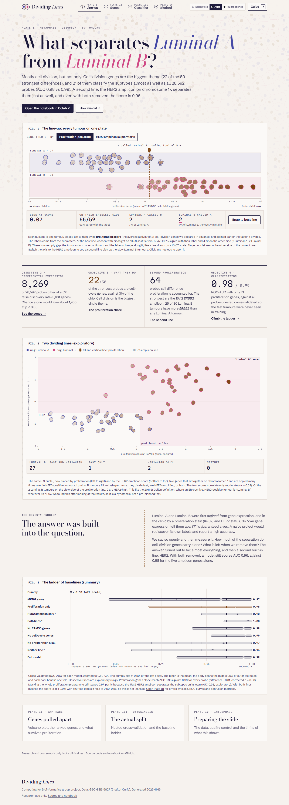
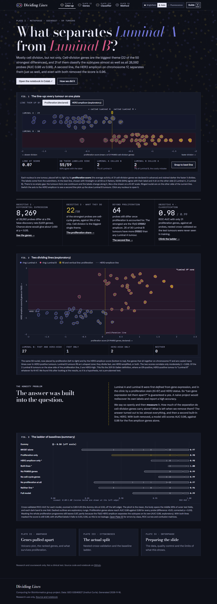
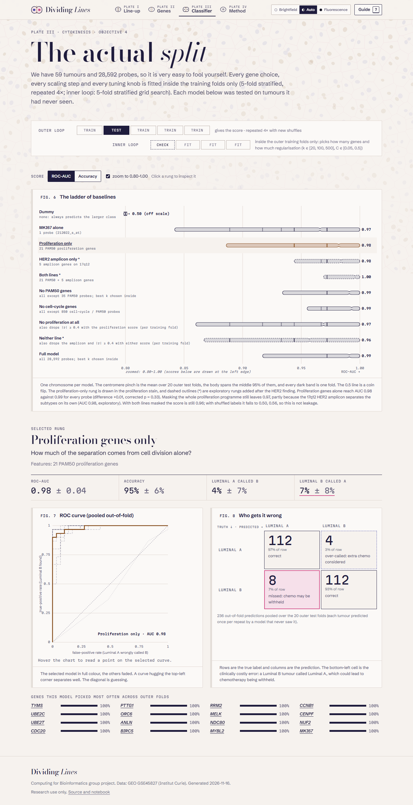
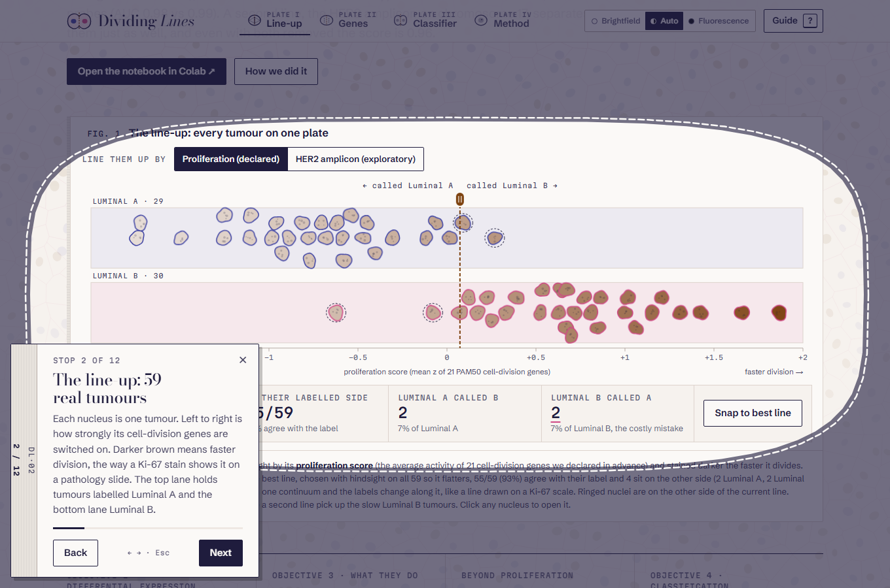
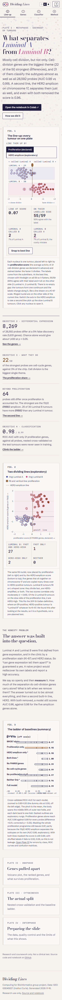

# Dividing Lines

**What separates Luminal A from Luminal B breast tumours?**

[](https://colab.research.google.com/github/DiorWachira/dividing-lines/blob/main/dividing_lines.ipynb)
[](https://diorwachira.github.io/dividing-lines/)
[](https://github.com/DiorWachira/dividing-lines/actions/workflows/site.yml)

A Computing for Bioinformatics group project. We use public microarray data from 59 breast tumours (GEO **GSE45827**, Institut Curie) to ask which gene-activity differences separate the two hormone-sensitive breast-cancer subtypes, and how well those differences classify them.

The title has two meanings. **Cell division** turns out to be most of the biological answer, and a **dividing line** is exactly what the subtype split is: a cut drawn through one continuous spread of tumours.



> **Research use only.** This is a coursework analysis. It must not inform any clinical decision. A Luminal B tumour misclassified as Luminal A could lead a clinician to withhold chemotherapy that a patient needed.

---

## The answer in one paragraph

**Mostly cell division, but not only.** Cell-division genes are the biggest single theme: 22 of the 50 strongest differences, with G2-M checkpoint and E2F targets at the top of the enrichment lists. Only the 21 PAM50 proliferation genes, declared before we looked at any result, classify the subtypes about as well as all 28,592 probes (nested cross-validated ROC-AUC **0.98 vs 0.99**). However, removing proliferation does *not* break the classifier. An unplanned second signal, the **17q12 HER2 (ERBB2) amplicon**, separates the subtypes just as well: 25 of 30 Luminal B tumours have more *ERBB2* than any Luminal A tumour. Even with both lines masked, a diffuse residue remains (AUC ≈ 0.96). Shuffling the labels drops every pipeline to a coin flip, so this residue is not data leakage. **Verdict on our hypothesis: partly supported.**

| Ladder rung (nested CV, 5 folds × 4 repeats) | ROC-AUC | Luminal B called A |
|---|---|---|
| Dummy (majority class) | 0.50 | 20% |
| *MKI67* alone | 0.97 ± 0.05 | 12% |
| **21 PAM50 proliferation genes** | **0.98 ± 0.04** | 7% |
| HER2 amplicon only *(exploratory)* | 0.98 ± 0.02 | 20% |
| Both lines: 26 genes *(exploratory)* | 1.00 ± 0.01 | 3% |
| No PAM50 genes | 0.99 ± 0.02 | 4% |
| No cell-cycle genes | 0.99 ± 0.02 | 8% |
| No proliferation signal at all | 0.97 ± 0.05 | 15% |
| Neither line *(exploratory)* | 0.96 ± 0.05 | 14% |
| **Full model, all probes** | **0.99 ± 0.03** | 4% |

*Exploratory* rungs were added after Stage 6 revealed the HER2 amplicon. They were not part of the declared plan, and the notebook labels them as such.

## Repository

| Path | What it is |
|---|---|
| [`dividing_lines.ipynb`](dividing_lines.ipynb) | **The main deliverable.** Eight stages, each opened and closed in plain language, saved with outputs. It runs top to bottom on CPU in about 4 minutes on a laptop (Colab's 2 vCPUs will take somewhat longer; the cross-validation grid was kept small for that). |
| [`figures/`](figures) | Every figure the notebook draws, saved as PNG |
| [`results/`](results) | The top 2,000 differentially expressed probes as CSV |
| [`requirements.txt`](requirements.txt) | Python packages (Colab already has all but `gseapy`, which the notebook installs) |
| [`web/`](web) | The interactive companion site (Vite + React + TypeScript), built from the notebook's exported numbers |
| [`docs/screenshots/`](docs/screenshots) | Screenshots of the site in light, dark and mobile |

### Run it
* **Colab (no setup):** click the badge above, then *Runtime → Run all*. The notebook downloads the data from NCBI itself, with no manual steps.
* **Locally:**
  ```bash
  python -m venv .venv && .venv/bin/pip install -r requirements.txt
  jupyter nbconvert --to notebook --execute --inplace dividing_lines.ipynb
  ```
  When it runs inside this repository, the last cell also refreshes `web/public/data/*.json` for the site.
* **Companion site:** `cd web && npm ci && npm run dev`. Tests: `npx playwright test` (desktop and mobile).

## Method in brief
1. **Data.** We download the GSE45827 series matrix from NCBI's FTP (that route worked, so the GEOparse fallback was not needed). We parse every metadata field and **assert 29 Luminal A and 30 Luminal B**. We use GSE45827 only, never merged with GSE65194, which is the same cohort reprocessed.
2. **QC.** The values are GC-RMA log₂ (max 17, median 6.6), so we did **not** log again. The submitters had already removed noise-level probes, so 29,873 of the chip's 54,675 remain. There were no missing values. We dropped 1,281 near-flat probes (SD < 0.2) and flagged no outliers. The subtypes are balanced across batches (χ² p = 0.74).
3. **EDA.** Boxplots, PCA, a heatmap and the *MKI67* check: 6.4× higher in Luminal B, p ≈ 5×10⁻¹⁴.
4. **Differential expression.** Welch's t-test per probe, Benjamini–Hochberg FDR, and Mann–Whitney as a check. **8,269 probes pass FDR 5%** (about 1,430 would pass p < 0.05 by chance alone). Gene symbols come from the GPL570 annotation, with an 89.9% match rate.
5. **Interpretation.** Offline GO enrichment and an online Hallmark cross-check (Enrichr). We measure the proliferation share with the declared PAM50 set. A regression adjusted for proliferation leaves 64 probes, led by the HER2 amplicon. We also build a co-expression network.
6. **Machine learning.** Gene selection, scaling and tuning all sit inside a scikit-learn `Pipeline` within **nested** stratified cross-validation, and masks are recomputed inside each training fold. We report AUC, accuracy and per-class error as mean ± SD across folds, compare rungs with a Nadeau–Bengio corrected paired t-test, and run a label-permutation leakage check.

## Limitations
* 59 tumours against 28,592 probes: every score is an estimate from one small cohort.
* The labels are built from what we measure (proliferation, and probably HER2 status), so a high score is partly guaranteed. GEO does not record which definition the submitters used.
* This is one French cohort, listed as Caucasian. Breast cancer in Kenyan and other African patients tends to present younger, with a larger triple-negative share, so the findings need local validation.
* Subtype calls disagree between methods, most often by moving Luminal A cases to Luminal B.
* These are processed intensities, not raw counts. The submitters' batch model kept tumour type as a factor, which can overstate group differences.

---

## The companion site: "The Plate"

**Live:** <https://diorwachira.github.io/dividing-lines/>

The site is designed from the project's own domain, not from a template. **The Plate** has two meanings. One is the *metaphase plate*, the line on which a dividing cell lines up its chromosomes before splitting in two. The other is the *atlas plates* of Walther Flemming's 1882 book, the first drawings of cell division. Every screen is a plate named after a phase of mitosis:

| Plate | Phase | Screen |
|---|---|---|
| I | Metaphase (everything lined up) | Overview and the line-up hero |
| II | Anaphase (the two sides pulled apart) | Genes: volcano, ranked table, what survives proliferation |
| III | Cytokinesis (the cell actually splits) | Classifier ladder, ROC, confusion matrices |
| IV | Interphase (preparing the material) | Data, QC, PCA, limitations |

**Signature pieces**
* **The line-up (hero):** all 59 tumours drawn as nuclei. Each outline is seeded by its GEO accession, and each fill is stained by its real proliferation score. A draggable **dividing line** has live counts for each error type; it is keyboard operable (← → Shift, B to snap) and you can switch the axis to the HER2 amplicon.
* **Two dividing lines:** a 2-D map with a proliferation line and a HER2 line, which shows the L-shaped "Luminal B zone".
* **The ideogram ladder:** each classifier is drawn as a chromosome. The body spans the middle 95% of fold scores, the centromere pinch sits at the mean, and each test fold is a G-band.
* **The iris tour:** a first-run guide whose spotlight closes like a microscope's field diaphragm. A pathologist's marker ring circles the target, and the explanations sit on a frosted slide label. It has 12 stops across all four plates and is opt-in.
* **Cytokinesis transition:** between plates, a cleavage furrow draws down the screen and the page splits apart. This is disabled under `prefers-reduced-motion`.
* **A generated tissue background:** a Voronoi "section" whose share of brown (Ki-67-positive) nuclei is the real cohort figure.

**Palette.** *Brightfield* (light mode) uses the stains of an immunohistochemistry slide: hematoxylin indigo for Luminal A, eosin rose for Luminal B, and **DAB brown reserved for proliferation**. *Fluorescence* (dark mode) re-images the same slide, with Ki-67 in a yellow pseudo-colour. The 3-colour set passes a colour-blind validator in both modes (worst all-pairs ΔE 9.9 light and 11.1 dark under deutan/protan simulation). **Type:** Bodoni Moda (display, after 19th-century scientific plates), Schibsted Grotesk (UI) and Martian Mono (data). Gene symbols are italic, following HGNC convention.

| Reference | What it became |
|---|---|
| Walther Flemming, *Zellsubstanz, Kern und Zelltheilung* (1882): [Wikipedia](https://en.wikipedia.org/wiki/Walther_Flemming), [scan on Zobodat](https://www.zobodat.at/pdf/MON-ALLGEMEIN_0377_0001-0424.pdf), [Linda Hall Library](https://www.lindahall.org/about/news/scientist-of-the-day/walther-flemming/) | "Plates" and figure numbering; the duotone Fig. 0 on the Method plate ([Wikimedia Commons, public domain](https://commons.wikimedia.org/wiki/File:Zellsubstanz-Kern-Kerntheilung.jpg)) |
| The metaphase plate and anaphase separation: [FSU Molecular Expressions](https://micro.magnet.fsu.edu/micro/gallery/mitosis/earlyanaphase.html) | The line-up layout, the mirror plot on gene pages, phase-named navigation |
| Ki-67 scoring on DAB/hematoxylin slides: [QuPath Ki-67 guide](https://cancer-informatics.pages.dev/docs/ai/qupath_04_ki67_index), [PMC3888090](https://pmc.ncbi.nlm.nih.gov/articles/PMC3888090) | Brown = proliferation; nuclei "stained" by their score; the tissue background |
| Cheang *et al.* 2009, the Ki-67 14% cut-off for Luminal B ([PMC3247054](https://pmc.ncbi.nlm.nih.gov/articles/PMC3247054)) | The draggable dividing line, read as a Ki-67-style threshold |
| St Gallen 2011 consensus (Goldhirsch *et al.*, [PMC3144634](https://pmc.ncbi.nlm.nih.gov/articles/PMC3144634)) | The "two dividing lines" figure: Luminal B = Ki-67 high *or* HER2-positive |
| Colour-blind-safe microscopy figures: [NKI guidelines](https://nki.nl/about-us/responsible-research/guidelines-color-blind-friendly-figures), [ASCB](https://ascb.org/?p=115811) | Validated stain palette; a yellow (not red) fluorescence pseudo-colour |
| NN/g on onboarding tutorials ([deck-of-cards study](https://www.nngroup.com/articles/mobile-tutorials/), [onboarding](https://www.nngroup.com/articles/mobile-app-onboarding/)) | The tour is opt-in, shown once, and always reopenable with `?` or the Guide key |
| Nygaard, Rødland & Hovig 2016 on batch correction ([PMC4679072](https://www.ncbi.nlm.nih.gov/pmc/articles/PMC4679072/)) | The batch-balance check and limitation 5 |

**Quality checks.** Light and dark modes, 390 px mobile with no horizontal overflow, keyboard focus throughout, and themed loading ("staining the slide"), error, empty and 404 ("off the slide") states. Playwright e2e tests cover the hero interaction, the guide (invite → tour across screens → Esc → never shown again), the help drawer and every route on desktop and mobile.

<p>
  
  
</p>
<p>
  
  
</p>

## Data, citations and licence
* **Data:** GEO [GSE45827](https://www.ncbi.nlm.nih.gov/geo/query/acc.cgi?acc=GSE45827) (Institut Curie, platform GPL570); linked paper Gruosso *et al.*, *EMBO Mol Med* 2016 ([PMID 27006338](https://pubmed.ncbi.nlm.nih.gov/27006338)). NCBI places no restrictions on GEO data; the submitters may hold rights. We cite them and do not redistribute the data.
* **Gene annotation:** GEO `GPL570.annot.gz`.
* **Other sources cited in the notebook:** Bourgon *et al.* 2010 (independent filtering); Nadeau & Bengio 2003 (corrected resampled t-test); Kenyan breast-cancer series ([Western Kenya, Notre Dame](https://curate.nd.edu/articles/journal_contribution/Aggressive_breast_cancer_in_western_Kenya_has_early_onset_high_proliferation_and_immune_cell_infiltration_/24728970/1), [PMC5792313](https://pmc.ncbi.nlm.nih.gov/articles/PMC5792313)); subtype discordance ([PMC6538748](https://pmc.ncbi.nlm.nih.gov/articles/PMC6538748), [Breast Cancer Res bcr1517](https://breast-cancer-research.biomedcentral.com/track/pdf/10.1186/bcr1517)).
* **Code:** MIT licence (see `LICENSE`).
